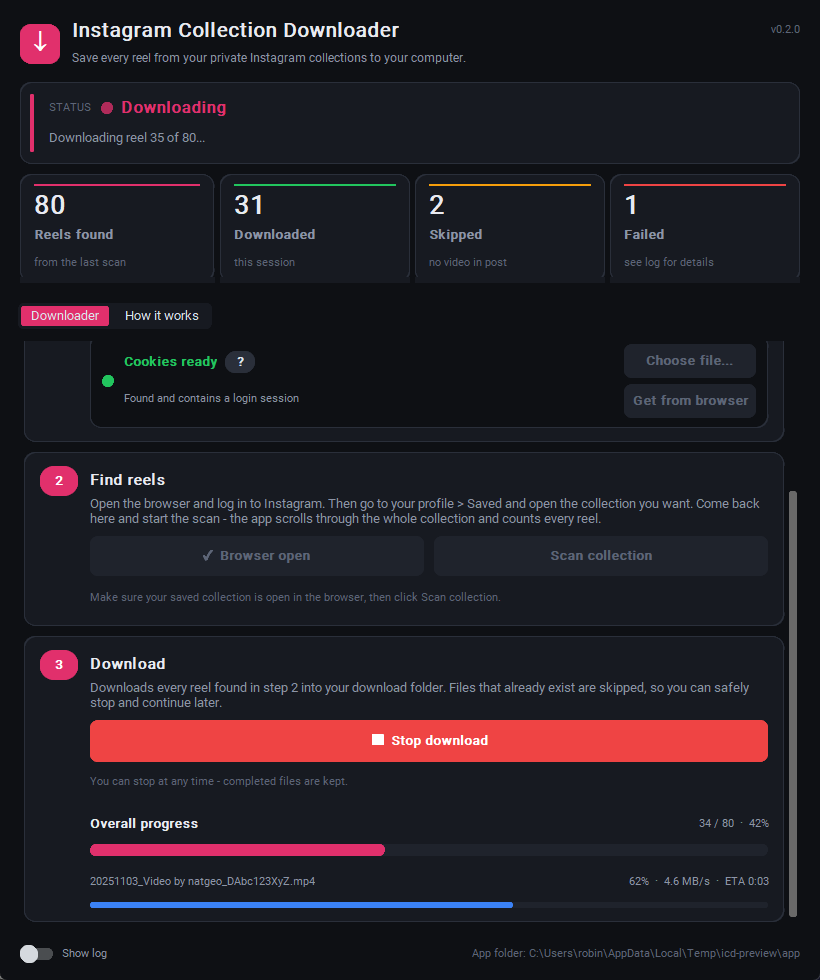

# Instagram Collection Downloader

A desktop app that downloads every reel from your **private Instagram saved collections** to your computer.

<div align="center">



</div>

The app guides you through three steps:

1. **Prepare**: pick a download folder and make sure your login cookies (`cookies.txt`) are found.
2. **Find reels**: log in through a browser window the app controls, open a saved collection, and let the app scroll through it and collect every reel.
3. **Download**: download everything with [yt-dlp](https://github.com/yt-dlp/yt-dlp) and watch the progress.

Every step is explained inside the app. Hover over a button for a tooltip, click the **?** next to the cookie status, or open the **How it works** tab. You don't need this README to use the app.

---

## ✨ Features

- **Modern dark interface** built with [CustomTkinter](https://github.com/TomSchimansky/CustomTkinter).
- **Live status indicator** with a colored accent: *Ready*, *Opening browser*, *Waiting for login*, *Searching*, *Downloading*, *Stopping*, *Done*, *Error*.
- **Counters** for reels found, downloaded, skipped (posts without video) and failed.
- **Download history**: remembers which reels were already downloaded, so each run only fetches what's new. Failed reels are retried next time.
- **"Only new reels" scan**: stops scrolling once it reaches reels you already downloaded, so updating a big collection takes seconds.
- **Two progress bars**: one for the whole collection, one for the current file (with speed and ETA).
- **Cookie check**: shows whether `cookies.txt` is present, valid and contains a login session. Downloading is blocked until a usable file is found, and the status updates as soon as you drop the file in.
- **One-click cookie export** from the app's own browser, so you don't need a browser extension.
- **Native folder picker** for the download location.
- **Stop at any time**: a stopped scan keeps the links found so far, and a stopped download continues where it left off.
- **Detailed log** (hidden by default), color-coded, for when you need to see what's going on.

---

## 🚀 Getting started

### Option A: Windows executable

1. Download `Instagram Collection Downloader.exe` from the [latest release](../../releases/latest), or build it yourself (see [Building the executable](#-building-the-executable)).
2. Put it in its own folder. `cookies.txt`, `links.txt` and the default `videos/` folder are created next to it.
3. Double-click to start.

### Option B: Run from source

Requirements: **Python 3.11+**, **Google Chrome**, and [uv](https://docs.astral.sh/uv/) (recommended).

```bash
git clone <this repository>
cd Instagram-Collection-Downloader
uv sync
uv run main.py           # or: uv run python -m collection_downloader
```

Without uv: `pip install customtkinter selenium webdriver-manager yt-dlp` and then `python main.py`.

**Optional:** install [FFmpeg](https://ffmpeg.org/download.html) and add it to your `PATH`. With FFmpeg, yt-dlp can merge the best video and audio streams. Without it, the app falls back to single-file formats, which may be lower quality.

> **Linux / WSL note:** the Python builds that `uv` downloads ship a Tk without anti-aliased font support, so the app will look pixelated there. Run it on Windows/macOS, or use a system Python with Tk (e.g. `sudo apt install python3-tk`) for proper rendering.

---

## 🔁 Downloading only newly saved reels

Every reel the app finds is stored in `links.txt` together with its status:

```
https://www.instagram.com/reel/ABC123	downloaded
https://www.instagram.com/reel/DEF456	pending
```

Statuses are `pending`, `downloaded`, `skipped` (no video in the post) and `failed`. Pending and failed reels are downloaded the next time you click **Download**. Downloaded and skipped reels are never fetched again.

Instagram lists a collection's **newest saves first**. With **Only new reels** turned on (step 2, on by default), the scan stops once it sees a few already-downloaded reels in a row (5 by default, adjustable). To keep a collection in sync, just **Scan → Download** whenever you've saved new reels. Turn the option off to scan the whole collection, for example after saving into the middle of an older collection.

**Clear history** (step 3) deletes `links.txt` so the app forgets everything and starts over. Your downloaded video files are not touched. An old `links.txt` with only URLs (one per line) is still read; every link in it counts as pending.

---

## 🍪 Getting your `cookies.txt`

Your saved collections are private, so the downloader needs your Instagram login cookies. The file stays on your computer, but **treat it like a password and never share it**.

**Easiest: use the app's browser**

1. In step 2, click **Open browser** and log in to Instagram.
2. In step 1, click **Get from browser**. The cookie status turns green.

**Alternative: browser extension**

1. Log in to instagram.com in your normal browser.
2. Install an exporter such as [Get cookies.txt LOCALLY](https://chromewebstore.google.com/detail/get-cookiestxt-locally/cclelndahbckbenkjhflpdbgdldlbecc) (Chrome/Edge) or [cookies.txt](https://addons.mozilla.org/en-US/firefox/addon/cookies-txt/) (Firefox).
3. Export the cookies for instagram.com in **Netscape format**.
4. Save the file as `cookies.txt` next to the app, or select it anywhere with **Choose file...**.

Cookies expire, and logging out invalidates them. If downloads suddenly fail, export them again.

---

## 🔨 Building the executable

### Automatic (GitHub Actions)

[`.github/workflows/build.yml`](.github/workflows/build.yml) builds the Windows executable on every push to `main` and every pull request. You can download the `.exe` from the run's **Artifacts** section.

To publish a release:

1. Bump `__version__` in `collection_downloader/__init__.py` (and `version` in `pyproject.toml`).
2. Commit, then tag and push:
   ```bash
   git tag v0.3.0
   git push origin v0.3.0
   ```
3. The workflow checks that the tag matches `__version__`, builds the `.exe` and attaches it to a new GitHub Release with auto-generated release notes.

### Manually

```bash
uv sync                      # installs PyInstaller from the dev dependency group
uv run pyinstaller --onefile --windowed --name "Instagram Collection Downloader" --collect-data customtkinter main.py
```

The executable is written to `dist/`. `--collect-data customtkinter` is required because CustomTkinter's themes and fonts must be bundled.

---

## 📁 Project structure

```
Instagram-Collection-Downloader/
├── .github/workflows/build.yml   # CI: build the .exe, publish releases on v* tags
├── main.py                       # Entry point (also used by PyInstaller)
├── pyproject.toml / uv.lock      # Dependencies (managed with uv)
└── collection_downloader/
    ├── __main__.py               # `python -m collection_downloader`
    ├── config.py                 # Paths and tuning constants
    ├── core/                     # GUI-independent logic, safe to run in worker threads
    │   ├── browser.py            # Selenium session: open Chrome, scroll & collect links, export cookies
    │   ├── downloader.py         # yt-dlp wrapper with progress callbacks and cancellation
    │   ├── cookies.py            # cookies.txt validation and Netscape export
    │   ├── links.py              # Link history (links.txt): links + download status
    │   └── utils.py              # Formatting helpers, "open folder"
    └── gui/
        ├── app.py                # Main window and controller (state machine, threading)
        ├── widgets.py            # Reusable widgets: status panel, stat cards, step cards, log, tooltips
        ├── dialogs.py            # Help dialog
        ├── help_content.py       # All help/tutorial texts in one place
        ├── states.py             # App states with label and accent color
        └── theme.py              # Colors and fonts
```

Files created at runtime next to the app: `cookies.txt` (you provide it), `links.txt` (the link history), and `videos/` (default download folder). All three are git-ignored.

**Architecture in short:** `core` knows nothing about the GUI. Long-running work (browser, scanning, downloading) runs in background threads and reports back through callbacks. The GUI marshals those callbacks onto the Tk main thread through a small dispatcher queue, so widgets are only ever touched from the main thread. Log messages travel the same way into the log panel.

---

## 🛠️ Troubleshooting

| Problem | Solution |
| --- | --- |
| Browser doesn't open | Install or update Google Chrome. |
| Scan finds 0 reels | Make sure you're logged in and the saved collection page is open before scanning. |
| Scan stops too early | Turn off **Only new reels** in step 2 to scan the whole collection. |
| Want to download everything again | Click **Clear history** in step 3 (files on disk aren't deleted, and existing files are skipped). |
| Many downloads fail | Your cookies are probably expired. Export them again. |
| "Skipped" count goes up | Those posts have no video (e.g. photo posts). This is expected. |
| Lower video quality | Install FFmpeg so video and audio streams can be merged. |
| Need more details | Turn on **Show log** at the bottom of the window. |

---

## ⚠️ Disclaimer

**For personal and educational use only.** Downloading content may violate Instagram's Terms of Service. Only download content you have the right to download. The developers are not responsible for any misuse.

## 📝 License

Open source under the MIT License. Originally created by [ShaadyEmad](https://github.com/ShaadyEmad).
